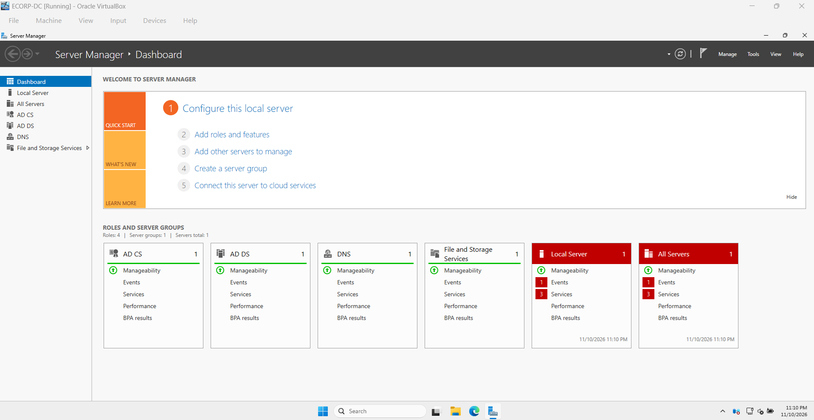
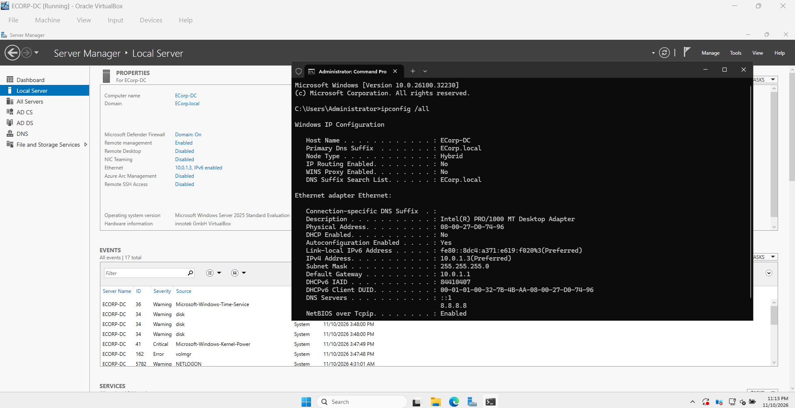
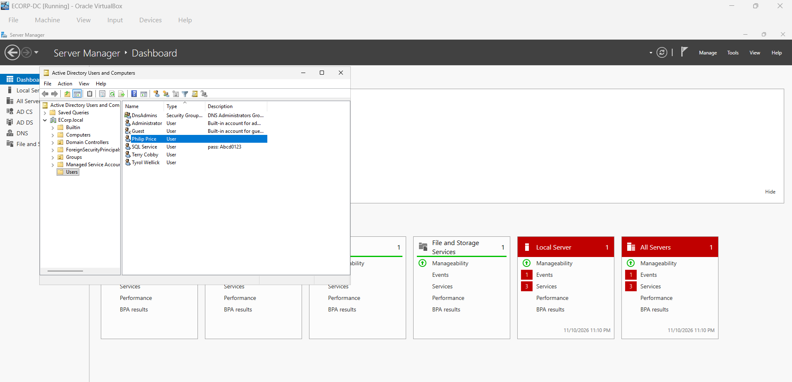
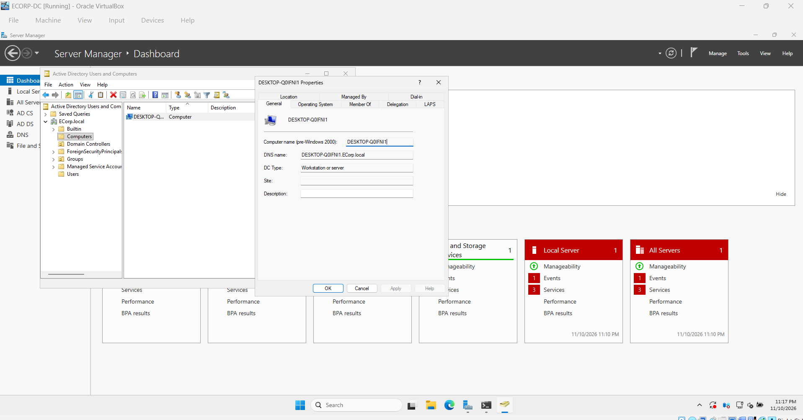

# 02 - Active Directory on Windows Server 2025

## Goal

Set up a Windows domain (`ECorp.local`) for the corporate network so the lab has a realistic Active Directory environment providing authentication (AD DS) and name resolution (DNS) for the Windows 11 workstation.

## Environment

| Item | Value |
| :--- | :--- |
| **VM Name** | `ECORP-DC` |
| **Hostname** | `ECorp-DC` |
| **OS** | Microsoft Windows Server 2025 Standard Evaluation |
| **Network** | VirtualBox Internal Network `LAN 0` (`ECORP`) |
| **IP Address** | `10.0.1.3/24`, Gateway `10.0.1.1` (pfSense), DNS `::1` & `8.8.8.8` |
| **Domain** | `ECorp.local` |

## Setup Steps

### 1. Install Roles in Server Manager
Installed Windows Server 2025 in BIOS mode, renamed the server to `ECorp-DC`, and added the **Active Directory Domain Services (AD DS)**, **DNS**, and **Active Directory Certificate Services (AD CS)** roles via Server Manager.

### 2. Configure Static IP & Promote to Domain Controller
Assigned `10.0.1.3/24` with default gateway `10.0.1.1` (pfSense) and promoted the server to the primary Domain Controller for the new forest `ECorp.local`.

### 3. Create Domain Users
Opened **Active Directory Users and Computers** (`dsa.msc`) under `ECorp.local > Users` and created the lab user accounts:
* **Philip Price** (`pprice`) — primary workstation user
* **Terry Cobby**
* **Tyrol Wellick**
* **SQL Service** (Service account with description `pass: Abcd0123` for credential exposure/hunting exercises)

### 4. Verify Workstation Domain Join
Confirmed that the Windows 11 workstation (`DESKTOP-Q0IFNI1`, DNS name `DESKTOP-Q0IFNI1.ECorp.local`) appears under `ECorp.local > Computers`.

