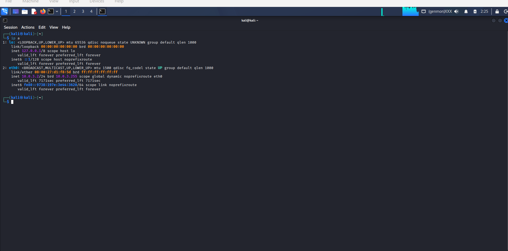

# 04 - Kali Linux Attacker & SIEM Server Machine

## Goal

Set up the Kali Linux machine (`KaliLinux-BASE`) on the isolated `ATTACKLAN` subnet (`10.0.3.0/24`). In this lab, Kali serves two purposes: simulating external attacks across the pfSense firewall and hosting the local Elasticsearch, Kibana, and Fleet Server instances for log analysis.

## Environment

| Item | Value |
| :--- | :--- |
| **VM Name** | `KaliLinux-BASE` |
| **Hostname** | `kali` |
| **OS** | Kali Linux |
| **Network** | VirtualBox Internal Network `LAN 1` (`ATTACKLAN`) |
| **Adapter & MAC** | `eth0` (Intel PRO/1000 MT Desktop), MAC `08:00:27:d1:f8:5d` |
| **IP Address** | `10.0.3.2/24` (Reserved via pfSense DHCP static mapping) |
| **Gateway** | `10.0.3.1` (pfSense `ATTACKLAN` interface) |

## Verification

*Running `ip a` on Kali confirms `eth0` is `UP` with IPv4 address `10.0.3.2/24` assigned by the pfSense DHCP server.*

## Setup Steps

1. **Connect to `ATTACKLAN`:** Set Adapter 1 in VirtualBox to Internal Network `LAN 1` (matching Adapter 3 `em2` on pfSense).
2. **Reserve IP `10.0.3.2`:** Added a DHCP static mapping on pfSense for MAC `08:00:27:d1:f8:5d` so Kali always receives `10.0.3.2`.
3. **Verify routing:** Confirmed connectivity to the pfSense gateway (`10.0.3.1`) and across the firewall to the `ECORP` subnet (`10.0.1.2` and `10.0.1.3`).
