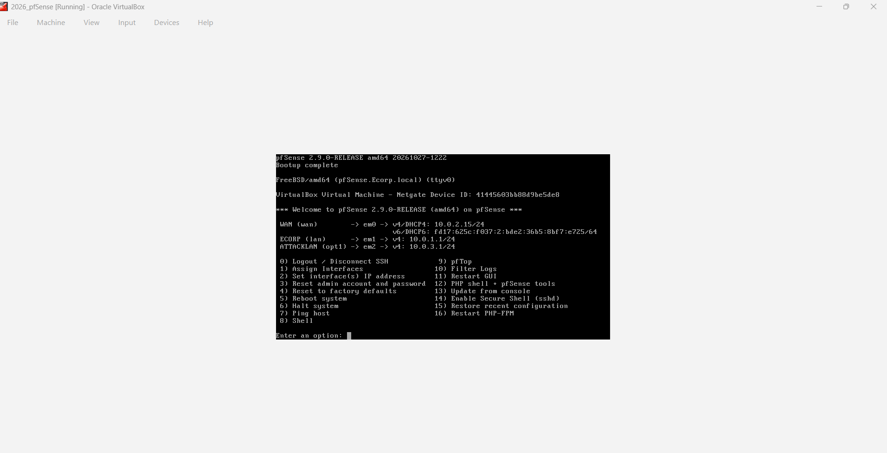
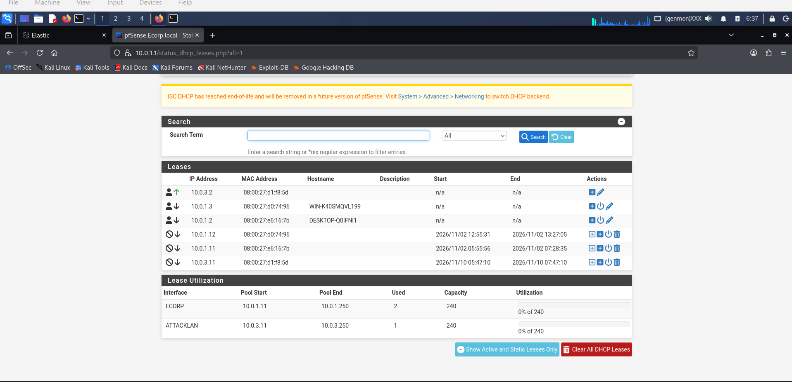
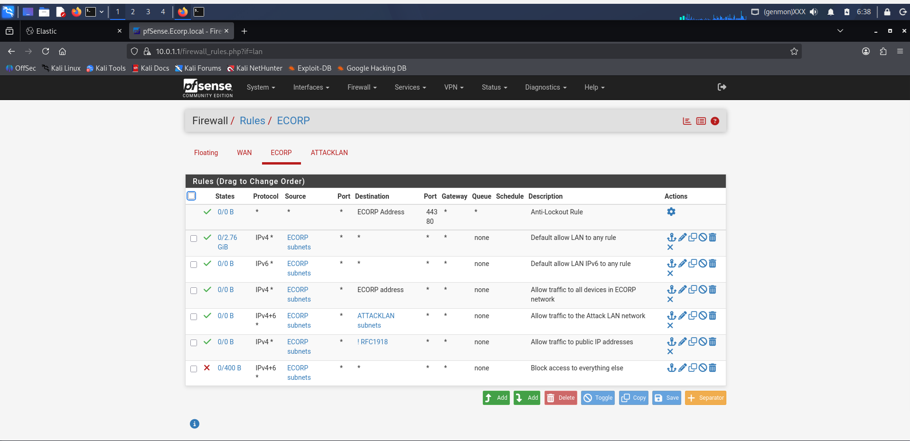
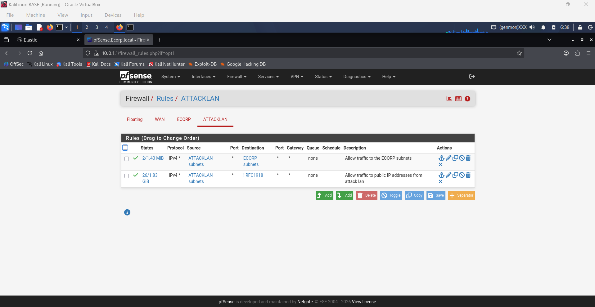

# 01 - pfSense: Interfaces, DHCP, and Firewall Rules

## Goal

Build the router and firewall that connects three networks: the Internet side (`WAN`), the corporate network (`ECORP`), and the attacker network (`ATTACKLAN`). Every flow between them passes through pfSense.

## Interface Configuration

*pfSense 2.9.0 console after interface assignment: WAN (`em0`) gets `10.0.2.15/24` from VirtualBox NAT, ECORP (`em1`) is `10.0.1.1/24`, and ATTACKLAN (`em2`) is `10.0.3.1/24`.*

| pfSense Name | Interface | IPv4 Address | Connected To |
| :--- | :--- | :--- | :--- |
| **WAN** | `em0` | `10.0.2.15/24` (DHCP, NAT) | Internet |
| **ECORP (lan)** | `em1` | `10.0.1.1/24` | `ECorp-DC` (`10.0.1.3`) and `pprice` workstation (`10.0.1.2`) |
| **ATTACKLAN (opt1)** | `em2` | `10.0.3.1/24` | Kali Linux (`10.0.3.2`) |

## Setup Steps

1. **Create the VM** (`2026_pfSense`, FreeBSD 64-bit, 3 network adapters). Adapter 1 is NAT, Adapter 2 is Internal Network `LAN 0` (`ECORP`), Adapter 3 is Internal Network `LAN 1` (`ATTACKLAN`).
2. **Install pfSense** from the ISO, remove the installation media, and reboot.
3. **Assign interfaces** from the console (Option `1`). Since the VM uses Intel PRO/1000 adapters, the interfaces appear as `em0`, `em1`, and `em2`.
4. **Set interface IPs** (Option `2`): `10.0.1.1/24` on `ECORP` and `10.0.3.1/24` on `ATTACKLAN`.
5. **Configure DHCP & Static Mappings** (`Services > DHCP Server`):
   * Dynamic pool on `ECORP`: `10.0.1.11` – `10.0.1.250`
   * Dynamic pool on `ATTACKLAN`: `10.0.3.11` – `10.0.3.250`
   * Reserved static leases for the lab machines so their IPs never change:
     * `10.0.3.2` (`08:00:27:d1:f8:5d`) -> Kali Linux
     * `10.0.1.3` (`08:00:27:d0:74:96`) -> `WIN-K40SMQVL199` / `ECorp-DC`
     * `10.0.1.2` (`08:00:27:e6:16:7b`) -> `DESKTOP-Q0IFNI1` (`pprice` workstation)

6. **Configure Firewall Rules** (`Firewall > Rules`) for `ECORP` and `ATTACKLAN`.

## Firewall Rules

### ECORP Interface Rules
Includes the Anti-Lockout rule, default allow rules, explicit pass rules to `ECORP address`, `ATTACKLAN subnets`, and public IPs (`! RFC1918`), followed by a final block rule.

### ATTACKLAN Interface Rules
| # | Action | Source | Destination | Purpose |
| :--- | :--- | :--- | :--- | :--- |
| 1 | Pass | `ATTACKLAN subnets` | `ECORP subnets` | Allow Kali (`10.0.3.2`) to reach the corporate network for lab exercises |
| 2 | Pass | `ATTACKLAN subnets` | `! RFC1918` | Allow Kali to reach the Internet while blocking access to other private subnets |

## Notes & Observations

1. **Web GUI access from ATTACKLAN:** Because Rule 1 on `ATTACKLAN` allows traffic to `ECORP subnets` (which includes pfSense's own `10.0.1.1` interface), the Kali machine can open the pfSense web interface at `https://10.0.1.1`. In a hardened setup, a block rule targeting `This Firewall (self)` on ports `80/443` should sit at the top of `ATTACKLAN`.
2. **Rule order on ECORP:** The default "Default allow LAN to any" rule sits above the more granular rules, so packets match the top rule first. Disabling the default allow rules forces traffic to hit the specific rules below it.
