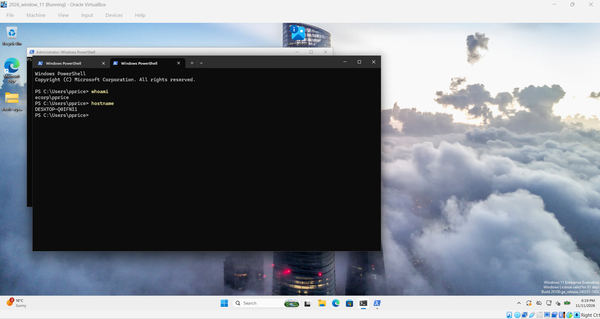
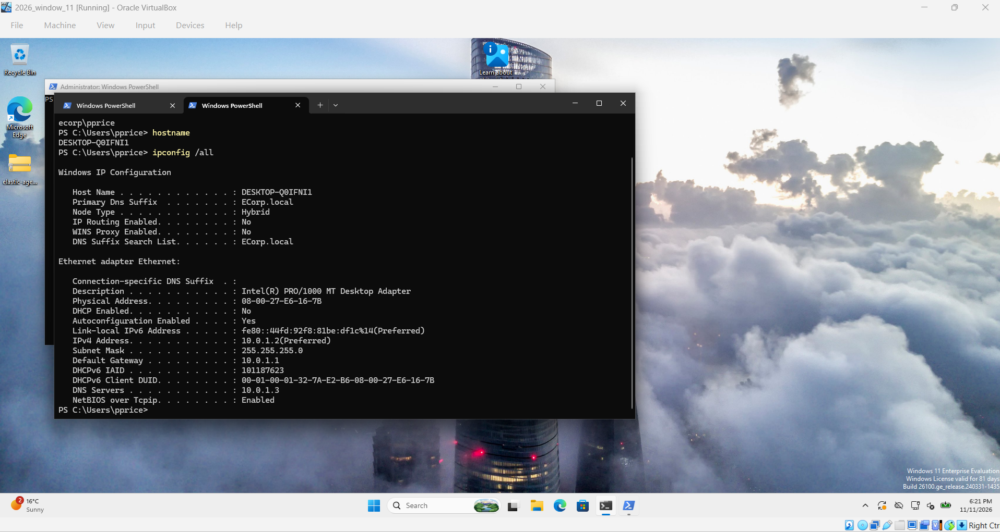

# 03 - Windows 11 Workstation (`pprice`) and Domain Join

## Goal

Add a user workstation (`2026_window_11`) to the `ECORP` network (`10.0.1.0/24`), join it to the `ECorp.local` domain, and use it as the monitored endpoint that ships Windows Security and Sysmon logs to the SIEM.

## Environment

| Item | Value |
| :--- | :--- |
| **VM Name** | `2026_window_11` (Workstation `pprice`) |
| **Hostname** | `DESKTOP-Q0IFNI1` (`DESKTOP-Q0IFNI1.ECorp.local`) |
| **Logged-in User** | `ecorp\pprice` (Philip Price) |
| **OS** | Windows 11 Enterprise Evaluation (Build 26100) |
| **Boot Mode** | BIOS (EFI disabled) |
| **Network** | VirtualBox Internal Network `LAN 0` (`ECORP`) |
| **MAC Address** | `08:00:27:E6:16:7B` |
| **IP Configuration** | `10.0.1.2/24`, Gateway `10.0.1.1` (pfSense), DNS `10.0.1.3` (`ECorp-DC`) |

## Setup Steps

1. **Create the VM** with Windows 11 settings and attach the Enterprise Evaluation ISO.
2. **Fix boot hang:** With EFI enabled, the VM stayed on a black screen. I disabled EFI in `Settings > System > Motherboard` and installed in Legacy BIOS mode.
3. **Bypass Windows 11 hardware check:** Since the VM does not have a virtual TPM or Secure Boot enabled, the installer stops with *"This PC doesn't meet Windows 11 system requirements"*. At the setup screen, I pressed `Shift + F10` to open Command Prompt and added the lab bypass registry keys:

```cmd
reg add HKLM\SYSTEM\Setup\LabConfig /v BypassTPMCheck /t REG_DWORD /d 1 /f
reg add HKLM\SYSTEM\Setup\LabConfig /v BypassSecureBootCheck /t REG_DWORD /d 1 /f
```

4. **Network & DNS setup:** Configured the workstation with IP `10.0.1.2/24`, default gateway `10.0.1.1` (pfSense), and pointed the DNS server to `10.0.1.3` (`ECorp-DC`) so it can resolve `ECorp.local`.
5. **Join the domain:** Joined `ECorp.local` via `Settings > System > About > Domain or workgroup`, rebooted, and signed in with the domain account `ecorp\pprice`.

## Verification

### 1. Domain User & Hostname Verification
Running `whoami` and `hostname` in PowerShell confirms the session is active under the domain user `ecorp\pprice` on host `DESKTOP-Q0IFNI1`:



### 2. Network & Domain Configuration (`ipconfig /all`)
Verifying that the Primary DNS Suffix is `ECorp.local`, IPv4 address is `10.0.1.2`, Default Gateway is `10.0.1.1`, and DNS Server points to the Domain Controller at `10.0.1.3`:


