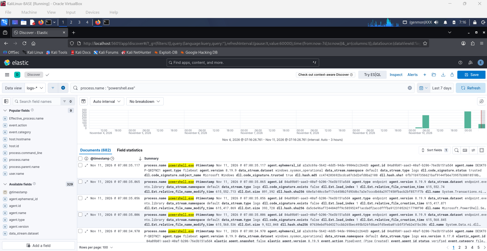
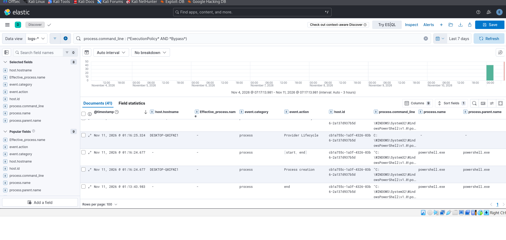
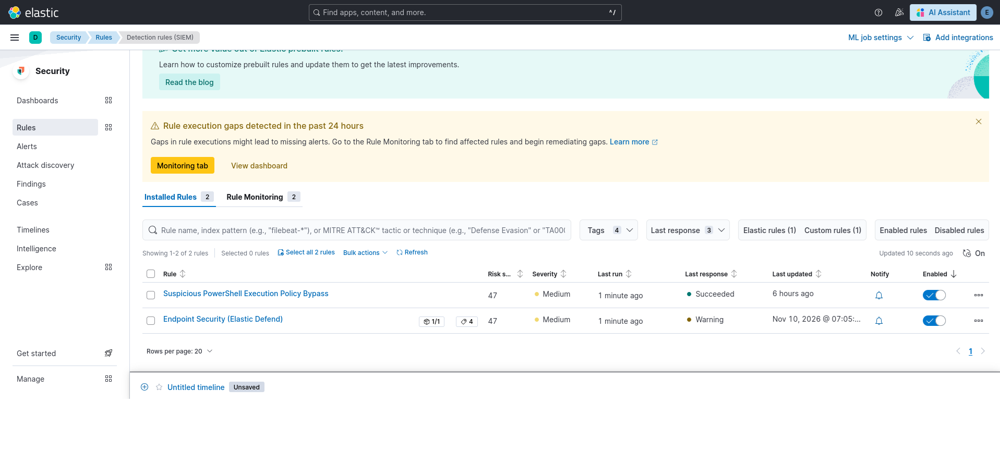
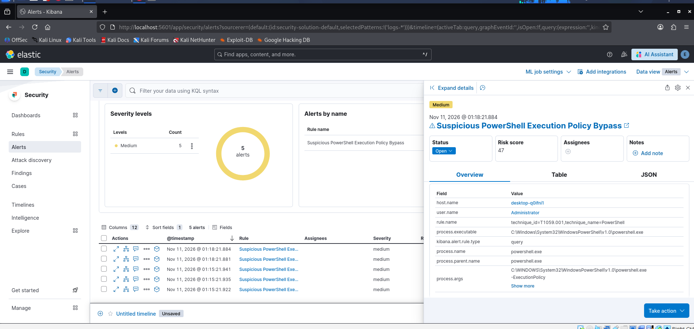

# Hunting PowerShell Activity & Creating a Custom Detection Rule

After enrolling the Windows 11 workstation (`DESKTOP-Q0IFNI1` / user `pprice`) into Fleet, I tested the SIEM detection workflow end-to-end: running a suspicious PowerShell command on the Windows machine, hunting for the raw telemetry in Kibana Discover, and creating a custom alert rule.

---

## 1. Simulating the Attack on the Windows Workstation

Attackers frequently use the `-ExecutionPolicy Bypass` flag in PowerShell to run unsigned scripts on a victim workstation without triggering default Windows script restrictions (MITRE ATT&CK **T1059.001 - Command and Scripting Interpreter: PowerShell**).

To simulate this behavior, I opened PowerShell on the Windows 11 machine (`DESKTOP-Q0IFNI1`) and ran commands using the execution policy bypass flag:

```powershell
powershell.exe -ExecutionPolicy Bypass ...
```

---

## 2. Hunting for Raw Logs in Kibana Discover

Next, I opened **Analytics > Discover** in Kibana (using the `logs-*` data view) to verify that Sysmon and Elastic Defend captured the process execution from `DESKTOP-Q0IFNI1`.

### Broad Search for PowerShell Events
First, I ran a general KQL filter to see all events related to `powershell.exe`:

```kql
process.name : "powershell.exe"
```

This returned 682 documents from `DESKTOP-Q0IFNI1` across both `windows.sysmon_operational` and `endpoint.events.library` datasets:



### Narrowing Down to the Execution Policy Bypass
To filter out normal background noise and isolate the exact bypass attempt, I refined the KQL query to inspect `process.command_line`:

```kql
process.command_line : (*ExecutionPolicy* AND *Bypass*)
```

This narrowed the results down to **41 matching documents** on `DESKTOP-Q0IFNI1`, showing the exact `Process creation` events where `powershell.exe` was spawned with the bypass arguments:



---

## 3. Creating the Custom Detection Rule

Once I confirmed the KQL query reliably caught the activity, I navigated to **Security > Rules > Detection rules (SIEM)** and created a custom query rule:

* **Rule Name:** `Suspicious PowerShell Execution Policy Bypass`
* **Rule Type:** Custom query (`logs-*`)
* **KQL Query:** `process.command_line : (*ExecutionPolicy* AND *Bypass*)`
* **MITRE ATT&CK Mapping:** `T1059.001` (PowerShell)
* **Severity:** `Medium` (Risk Score: `47`)

Both the built-in `Endpoint Security (Elastic Defend)` rule and my custom `Suspicious PowerShell Execution Policy Bypass` rule were enabled and scheduled to run automatically:



---

## 4. Reviewing the Triggered Alert

When the rule executed against the incoming logs from `DESKTOP-Q0IFNI1`, it triggered **5 Medium-severity alerts** in **Security > Alerts**.

Opening the alert details panel shows all the key triage fields needed by a SOC analyst:
* **Host:** `desktop-q0ifni1`
* **User:** `Administrator`
* **Rule / Technique:** `technique_id=T1059.001, technique_name=PowerShell`
* **Process Executable:** `C:\Windows\System32\WindowsPowerShell\v1.0\powershell.exe`
* **Process Arguments (`process.args`):** `C:\Windows\System32\WindowsPowerShell\v1.0\powershell.exe -ExecutionPolicy ...`


