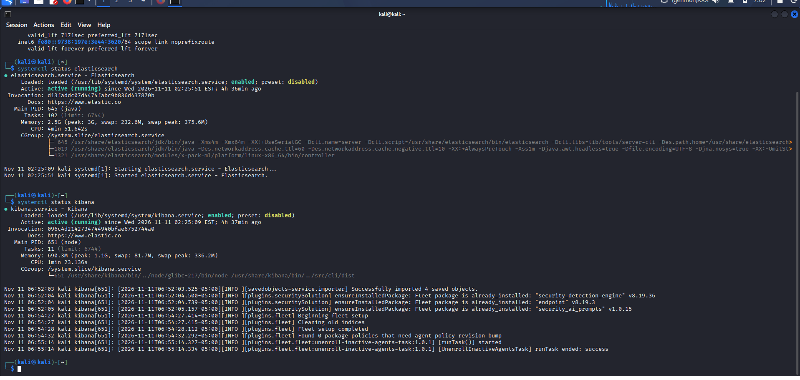
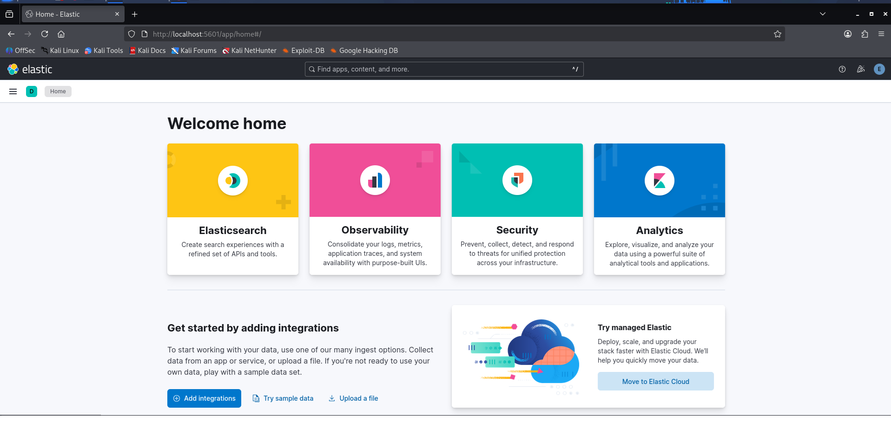
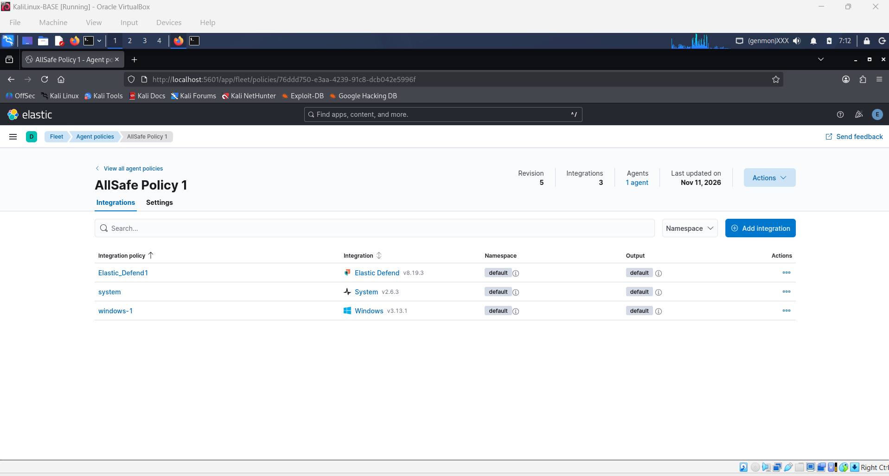
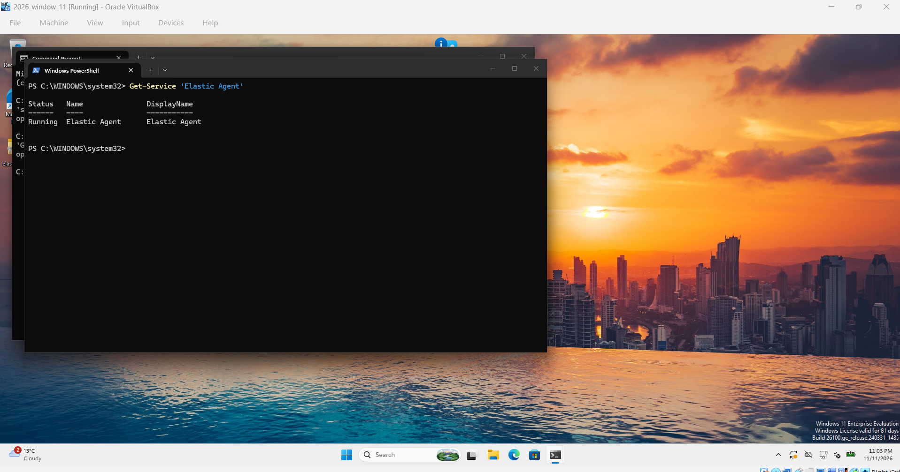
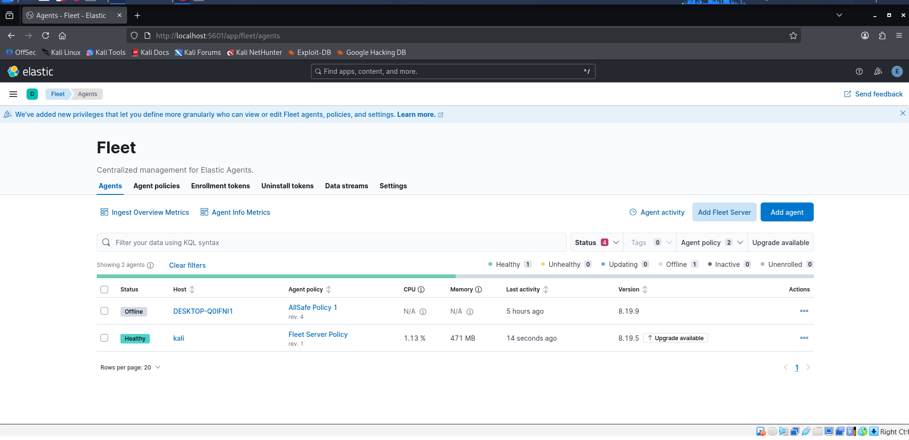

# Elastic SIEM & Fleet Configuration

This folder covers how I set up the Elastic Stack (Elasticsearch & Kibana `v8.19`), configured Fleet to manage endpoint agents, and enrolled the Windows 11 workstation (`2026_window_11` / `DESKTOP-Q0IFNI1`, user `pprice`) to ship Windows and Sysmon logs to the SIEM.

---

## 1. Starting Elasticsearch and Kibana on Kali

I hosted both **Elasticsearch** and **Kibana** on the `KaliLinux-BASE` (`10.0.3.2`) machine. Before configuring the agents, I verified that `elasticsearch.service` and `kibana.service` were enabled and running under `systemd`:

```bash
sudo systemctl status elasticsearch
sudo systemctl status kibana
```



Once both services were active, I opened the Kibana web interface at `http://localhost:5601`:



---

## 2. Setting up the Fleet Agent Policy (`AllSafe Policy 1`)

To collect telemetry from the Windows 11 workstation (`pprice`), I navigated to **Management > Fleet > Agent policies** and created **`AllSafe Policy 1`**. 

I added three integrations to this policy so the agent collects both OS logs and endpoint security events:
* **Elastic Defend (`v8.19.3`)**: Endpoint detection and process/file telemetry.
* **System (`v2.6.3`)**: Core system metrics and logs.
* **Windows (`v3.13.1`)**: Windows Event Logs (including Sysmon Operational logs and Security events).



---

## 3. Enrolling the Windows 11 Workstation (`DESKTOP-Q0IFNI1`)

On the Windows 11 workstation (`10.0.1.2`, logged in as `ecorp\pprice`), I installed the **Elastic Agent** and enrolled it into the Fleet Server using `AllSafe Policy 1`.

To confirm the agent was running properly on the Windows endpoint, I checked the service status in PowerShell:

```powershell
Get-Service 'Elastic Agent'
```



---

## 4. Verifying Enrolled Agents in Fleet

Back in Kibana under **Fleet > Agents**, both the local Fleet Server (`kali`) and the Windows 11 workstation (`DESKTOP-Q0IFNI1` assigned to `AllSafe Policy 1`) appear in the central management console:



---

## Next Step: Log Hunting & Detection Rules

See **[Basic rule/README.md](./Basic%20rule/README.md)** for the step-by-step walkthrough of how I simulated a suspicious PowerShell execution on the Windows workstation, hunted for the logs in Kibana Discover, and built a custom SIEM alert.
