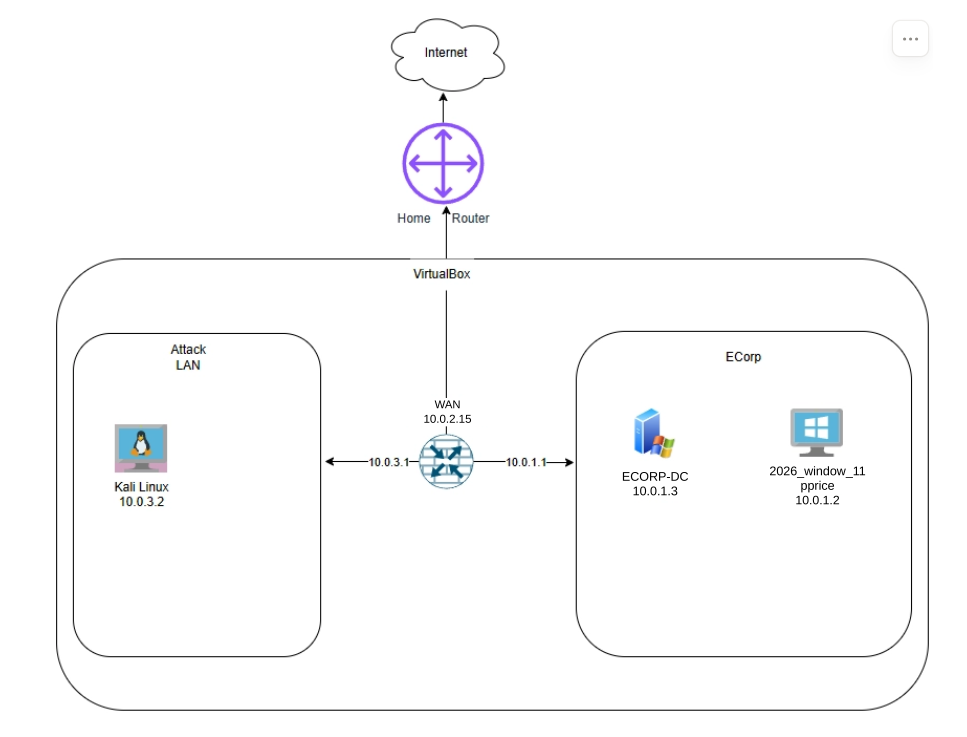

# Active Directory & SIEM Detection Home Lab

I built this VirtualBox home lab to simulate a small corporate Active Directory network (`ECorp.local`), segment it behind a pfSense firewall, and practice shipping endpoint logs to Elastic Security (ELK) and Splunk for threat detection.

## Network Topology

All traffic between the corporate LAN (`ECorp`) and the attacker subnet (`Attack LAN`) routes through the **pfSense** firewall.

| VM Name | Hostname / User | IP Address | OS & Role |
| :--- | :--- | :--- | :--- |
| `2026_pfSense` | `pfSense.Ecorp.local` | **WAN (`em0`):** `10.0.2.15/24` **ECORP (`em1`):** `10.0.1.1/24` **ATTACKLAN (`em2`):** `10.0.3.1/24` | FreeBSD pfSense 2.9.0 Firewall, Router & DHCP Server |
| `ECORP-DC` | `ECorp-DC` | `10.0.1.3/24` | Windows Server 2025 Standard — Domain Controller (`ECorp.local`), AD DS, DNS, AD CS |
| `2026_window_11` | Host: `DESKTOP-Q0IFNI1` User: `ecorp\pprice` | `10.0.1.2/24` | Windows 11 Enterprise workstation joined to `ECorp.local`, running Sysmon & Elastic Agent |
| `KaliLinux-BASE` | `kali` | `10.0.3.2/24` | Kali Linux — Attacker machine & hosts the Elasticsearch / Kibana / Fleet server (`v8.19`) |

---

## Lab Documentation & Folders

### 1. [Architecture/](./Architecture/)
Step-by-step notes and screenshots for building the virtual network and Active Directory domain:
* **[01 - pfSense Firewall, DHCP & Rules](./Architecture/pfsense/README.md)**: Configuring `em0`, `em1`, `em2`, static DHCP leases, and firewall rules between `ECORP` and `ATTACKLAN`.
* **[02 - Active Directory on Windows Server 2025](./Architecture/active-directory/README.md)**: Setting up `ECorp-DC` (`10.0.1.3`), promoting it to a Domain Controller for `ECorp.local`, and creating domain accounts (`Philip Price` / `pprice`, `Terry Cobby`, `Tyrol Wellick`, `SQL Service`).
* **[03 - Windows 11 Workstation (`pprice`)](./Architecture/window/README.md)**: Bypassing TPM/Secure Boot in VirtualBox, joining `DESKTOP-Q0IFNI1` (`10.0.1.2`) to `ECorp.local`, and logging in as `ecorp\pprice`.
* **[04 - Kali Linux (`10.0.3.2`)](./Architecture/kali/README.md)**: Connecting Kali to `ATTACKLAN` (`LAN 1`) and verifying network reachability across pfSense.

### 2. [Elastic/](./Elastic/)
Setting up the Elastic Stack (SIEM), enrolling the Windows 11 workstation via Fleet, hunting through logs in Kibana, and building custom detection alerts:
* **[Elastic SIEM & Fleet Agent Setup](./Elastic/README.md)**: Running `elasticsearch` and `kibana` on Kali, creating `AllSafe Policy 1` (`Windows`, `System`, and `Elastic Defend` integrations), and enrolling `DESKTOP-Q0IFNI1`.
* **[Log Hunting & Custom Detection Rule (`Basic rule`)](./Elastic/Basic%20rule/README.md)**: Triggering a PowerShell Execution Policy Bypass on the Windows machine, searching for the event in Kibana Discover with KQL, and configuring the `Suspicious PowerShell Execution Policy Bypass` alert (`T1059.001`).
